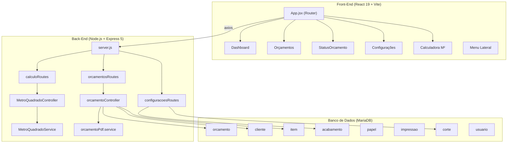
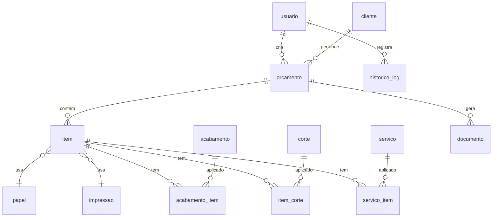

# 📊 Análise Completa — Sistema Gráfica Máxima

## 1. Visão Geral do Projeto

| Aspecto | Detalhe |
|---------|---------|
| **Nome** | Gráfica Máxima — Squad 01 |
| **Contexto** | Projeto de Residência em Software — Porto Digital / UCB |
| **Objetivo** | Centralizar orçamentos, substituir processos manuais e melhorar o controle financeiro de uma gráfica |
| **Stack** | React 19 (Vite) + Node.js/Express 5 + MariaDB (XAMPP) |
| **Repo** | `github.com/llannkkj/squad01-graficamaxima-mvp` |

---

## 2. Arquitetura do Sistema

### Padrão Arquitetural
O backend segue uma organização em **camadas MVC** (routes → controllers → services → config/db), o que é adequado para o escopo do MVP. O frontend usa **roteamento por páginas** com componentes reutilizáveis.

---

## 3. Modelo de Dados (Banco)

O banco `graficamaxima` possui **12 tabelas** com relacionamentos via FK:

> [!NOTE]
> As tabelas `documento`, `historico_log`, `servico` e `servico_item` existem no schema mas **não são utilizadas pelo código da aplicação** atualmente.

---

## 4. Funcionalidades Implementadas vs. Documentação

| Funcionalidade (Doc PDF) | Status no Código | Observação |
|--------------------------|:---:|------------|
| Dashboard com métricas | ⚠️ **Parcial** | Cards com valores **hardcoded** (`R$ 1200`, `1200`, `12`) — não consulta o banco |
| Gráfico de evolução mensal | ⚠️ **Parcial** | Componente `grafico.jsx` existe mas com dados estáticos |
| CRUD de Orçamentos | ✅ **Completo** | Criar, listar, editar, deletar — tudo conectado ao banco |
| Fluxo em 3 etapas (Cliente → Serviço → Custos) | ✅ **Completo** | Modal com wizard de 3 steps funcional |
| Status/Andamento de orçamento | ✅ **Completo** | Stepper visual + checkboxes + persistência |
| Geração de PDF | ✅ **Completo** | PDFKit no backend, download via blob no frontend |
| Calculadora de M² (flutuante) | ✅ **Completo** | Componente global com botão FAB + integração API |
| Configurações (abas de acabamentos) | ✅ **Completo** | CRUD de acabamentos/corte por abas + Metro Quadrado via JSON |
| Gerenciamento de Papéis | ⚠️ **Parcial** | Página `Papeis.jsx` existe mas usa abas limitadas |
| Cadastro/Login de Usuário | ❌ **Não implementado** | Middleware JWT existe, rotas de auth estão **comentadas** |
| Tela de Login/Registro | ❌ **Não implementado** | Documentação mostra tela "Crie uma Conta", mas não há no código |
| Tabela de "Últimos Orçamentos" no Dashboard | ⚠️ **Parcial** | Componente renderizado mas sem passagem de dados do banco |
| Motor de aproveitamento de folha (66x96cm) | ❌ **Não implementado** | Documentação menciona "motor gráfico nativo", mas não há esse cálculo |
| Imutabilidade ACID de preços | ❌ **Não implementado** | Valores não são "congelados" — alterações de preço afetam todos |
| Auditoria / Logs | ❌ **Não implementado** | Tabela `historico_log` e `LogService.js` existem mas não são usados |

---

## 5. Análise de Qualidade do Código

### 5.1 ✅ Pontos Positivos

- **Transações ACID** no `criarOrcamento` — usa `beginTransaction`, `commit` e `rollback`
- **Conexão resiliente** ao banco — tenta porta 3306, falha? Tenta 3312 automaticamente
- **Blindagem de FK** — verifica/insere registros padrão de `papel` e `impressao` para evitar erros 500
- **Fallback na listagem** — se o JOIN falhar, faz SELECT simples como contingência
- **Formatação BR** — moeda, datas e números formatados com `Intl.NumberFormat`
- **Masks de input** — CPF/CNPJ e CEP com formatação automática
- **Geração de PDF** bem estruturada — layout profissional com PDFKit puro

### 5.2 ⚠️ Problemas Identificados

#### Segurança

> [!CAUTION]
> **Arquivo `.env` commitado no repositório** com credenciais do banco (senha root vazia). Isso é um risco de segurança. O `.env` deveria estar no `.gitignore`.

> [!WARNING]
> **Autenticação completamente desativada** — as rotas de auth estão comentadas no `server.js`. Qualquer pessoa na rede pode acessar/modificar todos os dados via API sem autenticação.

> [!WARNING]
> **Senha do usuário admin no SQL dump** é `hash_seguro_123` — armazenada em **texto plano**, não é um hash real. Não há uso de bcrypt ou similar.

#### Arquitetura e Código

| Problema | Arquivo | Impacto |
|----------|---------|---------|
| Dashboard com dados hardcoded | [Dashboard.jsx](file:///c:/Users/kauat/OneDrive/Documentos/UCB/2%C2%B0%20Semestre/residencia/grafica-maxima/squad01-graficamaxima-mvp/Grafica-Maxima-FrontEnd/src/Paginas/Dashboard.jsx#L26-L47) | Cards mostram `R$ 1200` fixo, não refletem dados reais |
| `node_modules` no repositório | README.md | Repositório inflado desnecessariamente (~100MB+) |
| Rotas duplicadas com/sem `/api` | [configuracoesRoutes.js](file:///c:/Users/kauat/OneDrive/Documentos/UCB/2%C2%B0%20Semestre/residencia/grafica-maxima/squad01-graficamaxima-mvp/Grafica-Maxima-Backend/src/routes/configuracoesRoutes.js#L45-L46) | Cada rota é registrada 2x para contornar bugs |
| `nodemon` como dependency de produção | [package.json](file:///c:/Users/kauat/OneDrive/Documentos/UCB/2%C2%B0%20Semestre/residencia/grafica-maxima/squad01-graficamaxima-mvp/Grafica-Maxima-Backend/package.json#L15) | Deveria ser `devDependency` |
| CORS fixo para `localhost:5173` | [server.js](file:///c:/Users/kauat/OneDrive/Documentos/UCB/2%C2%B0%20Semestre/residencia/grafica-maxima/squad01-graficamaxima-mvp/Grafica-Maxima-Backend/server.js#L14) | Não permite deploy em produção |
| Comentários `//` no `.env` | [.env](file:///c:/Users/kauat/OneDrive/Documentos/UCB/2%C2%B0%20Semestre/residencia/grafica-maxima/squad01-graficamaxima-mvp/Grafica-Maxima-Backend/.env#L1) | `.env` usa `#` para comentários, `//` é interpretado como parte do valor |
| Preços persistidos em JSON no filesystem | [precos.json](file:///c:/Users/kauat/OneDrive/Documentos/UCB/2%C2%B0%20Semestre/residencia/grafica-maxima/squad01-graficamaxima-mvp/Grafica-Maxima-Backend/src/services/precos.json) | Mistura de persistência (DB + arquivo), risco de perda em deploy |
| Race condition na inicialização do DB | [db.js](file:///c:/Users/kauat/OneDrive/Documentos/UCB/2%C2%B0%20Semestre/residencia/grafica-maxima/squad01-graficamaxima-mvp/Grafica-Maxima-Backend/src/config/db.js#L56-L61) | Se query chegar antes do pool estar pronto, usa `setTimeout(500ms)` como workaround |
| Rotas/arquivos vazios no backend | Vários | `financeiroRoutes.js`, `pedidosRoutes.js`, `produtosRoutes.js`, `DashBoardController.js`, `Orcamento.js` — arquivos sem tamanho reportado |
| Uso de `alert()` para feedback | Múltiplos arquivos frontend | UX ruim — deveria usar toast/snackbar |
| Inline styles extensivos | [App.jsx](file:///c:/Users/kauat/OneDrive/Documentos/UCB/2%C2%B0%20Semestre/residencia/grafica-maxima/squad01-graficamaxima-mvp/Grafica-Maxima-FrontEnd/src/App.jsx#L36-L53) | Mistura de CSS em arquivo e inline styles dificulta manutenção |

---

## 6. Cobertura de Testes

> [!IMPORTANT]
> **Não há testes automatizados.** A documentação menciona Jest e ESLint como "Quality Gate", mas:
> - Não há pasta `tests/` ou `__tests__/`
> - Não há `jest` nas dependências do projeto
> - ESLint está configurado no frontend mas sem regras customizadas significativas
> - Nenhum script de teste no `package.json` do backend

---

## 7. Mapeamento de Endpoints da API

| Método | Rota | Função |
|--------|------|--------|
| `GET` | `/api/orcamentos` | Listar todos os orçamentos |
| `POST` | `/api/orcamentos` | Criar orçamento (transacional) |
| `PUT` | `/api/orcamentos/:id` | Editar orçamento |
| `DELETE` | `/api/orcamentos/:id` | Deletar orçamento |
| `GET` | `/api/orcamentos/status-orcamento/:id` | Obter status de um orçamento |
| `PUT` | `/api/orcamentos/status-orcamento/:id` | Atualizar status |
| `GET` | `/api/orcamentos/:id/pdf` | Gerar PDF do orçamento |
| `GET` | `/api/calculo/tipos` | Listar tipos e preços m² |
| `POST` | `/api/calculo/metro-quadrado` | Calcular e salvar item m² |
| `POST` | `/api/calculo/metro-quadrado/simulacao` | Simulação (sem salvar) |
| `PUT` | `/api/calculo/tipos/atualizar` | Atualizar preço no JSON |
| `GET` | `/configuracoes/:aba` | Buscar configurações por aba |
| `POST` | `/configuracoes/:aba` | Criar item de configuração |
| `PUT` | `/configuracoes/:aba/:id` | Editar item de configuração |
| `DELETE` | `/configuracoes/:aba/:id` | Remover item de configuração |

---

## 8. Análise de Gaps: Documentação vs. Realidade

A documentação PDF (21 páginas de apresentação) descreve um sistema **mais completo** do que o que está implementado:

### Funcionalidades documentadas mas NÃO implementadas:
1. **Sistema de Autenticação/Login** — Tela de "Crie uma Conta" no PDF, código comentado
2. **Motor de aproveitamento de folha** — Mencionado como "diferencial técnico"
3. **Imutabilidade de preços em orçamentos** — Documentada como "ACID", não existe
4. **Dashboard dinâmico** — PDF mostra R$ 9.700 + gráficos reais, código mostra valores fixos
5. **Caching em memória** — Mencionado como "resiliência", não implementado
6. **Auditoria/Logs** — Tabelas existem mas nenhum log é gravado
7. **CI/CD** — Documentação menciona pipeline, mas não há configuração (sem `.github/workflows`)
8. **Testes unitários com Jest** — Documentação menciona, mas não existem

### Funcionalidades implementadas mas POUCO documentadas:
1. **Calculadora flutuante de M²** — Funcionalidade rica mas submencionada
2. **Geração de PDF** com layout profissional — Bem implementado
3. **Gerenciamento de preços via arquivo JSON** — Abordagem criativa mas não documentada

---

## 9. Recomendações Prioritárias

### 🔴 Críticas (Fazer Agora)
1. **Remover `.env` do repositório** e adicionar ao `.gitignore`
2. **Ativar autenticação** — descomentar e implementar as rotas de auth
3. **Hashear senhas** — usar `bcrypt` no lugar de texto plano
4. **Remover `node_modules`** do repositório — usar `.gitignore`

### 🟡 Importantes (Próxima Sprint)
5. **Dinamizar o Dashboard** — fazer cards consumirem dados reais via API
6. **Unificar persistência** — migrar `precos.json` para o banco de dados
7. **Adicionar testes** — pelo menos para os cálculos de m² e criação de orçamentos
8. **Corrigir `.env`** — trocar `//` por `#` nos comentários
9. **Remover rotas duplicadas** `/configuracoes` e `/api/configuracoes`

### 🟢 Melhorias (Futuro)
10. **Substituir `alert()` por toasts** — usar biblioteca como `react-hot-toast`
11. **Implementar auditoria** — ativar o `LogService` e gravar logs de alterações
12. **Adicionar validação de formulário** — campos obrigatórios no frontend
13. **Configurar CORS dinâmico** via variável de ambiente
14. **Mover `nodemon` para devDependencies**
15. **Extrair estilos inline** para os arquivos CSS existentes

---

## 10. Conclusão

O **Gráfica Máxima** é um MVP funcional que cumpre seu objetivo central: **permitir a criação, gestão e acompanhamento de orçamentos gráficos**. O fluxo de criação em 3 etapas, o cálculo de m², a geração de PDF e o gerenciamento de configurações estão bem implementados e integrados.

No entanto, há uma **divergência significativa entre a documentação e o código**. A apresentação descreve funcionalidades (autenticação, motor de folha, imutabilidade ACID, CI/CD, testes) que não existem na implementação. As questões de **segurança** (credenciais expostas, autenticação desativada, senhas em texto plano) são os pontos mais críticos a serem endereçados.

Para um projeto de residência/MVP, o resultado é **sólido na parte funcional core**, mas precisa de trabalho adicional nas áreas de segurança, testes e alinhamento com a documentação.
