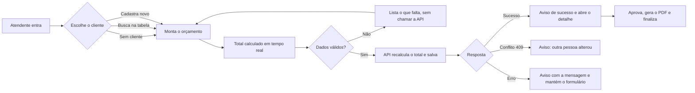

# Entrega Parcial RiseUp — Gráfica Máxima (Squad 01)

Residência em Software & IA · Porto Digital · Prazo de entrega: _[preencher]_
Documento atualizado em 17/11/2026. Sistema no ar: https://squad01-graficamaxima-mvp.vercel.app (API e banco verificados em 17/11/2026: `/health` respondeu `ok`).

Este documento responde, na ordem, aos cinco blocos do roteiro "Entrega Parcial RiseUp" e traz, no bloco 6, o comparativo **antes** (MVP original, junho de 2026) e **depois** (sistema atual).

## Conferência do roteiro

Legenda: ✅ pronto e verificável no repositório · ⚠️ pronto, mas depende de confirmação da equipe · ❌ falta e não pode ser inventado.

| Bloco | Item do roteiro | Situação | Onde está |
|---|---|---|---|
| 1 | Problema (250 caracteres) | ✅ 234 caracteres | seção 1.1 |
| 1 | Solução (250 caracteres) | ✅ 224 caracteres | seção 1.1 |
| 1 | Onde a IA gera valor | ✅ | seção 1.2 |
| 1 | Personas | ✅ (ficcionais, baseadas nos perfis reais do sistema) | seção 1.3 |
| 1 | Cenários de falha e casos de borda | ✅ | seção 1.4 |
| 1 | Entrevista com agente inteligente | ⚠️ feita por IA e marcada como simulada | seção 1.5 |
| 1 | **Entrevista com humanos (mínimo uma)** | ❌ **falta realizar e anexar** | seção 1.5 |
| 2 | Épicos, histórias, tarefas | ✅ | seção 2.1 |
| 2 | Padrões de uso de IA | ✅ | seção 2.2 |
| 2 | Critérios de aceite e garantia de IA | ✅ | seção 2.3 |
| 3 | Wireframes, telas e estados | ✅ (capturas reais; não há protótipo desenhado à mão) | seção 3 |
| 3 | Navegação e fluxo completo | ✅ | seções 3.2 e 3.3 |
| 3 | Design system, acessibilidade, estados de erro | ✅ medido em 11/11; precisa repetir após as mudanças de 17/11 | seções 3.4 a 3.6 |
| 4 | Stack e ferramentas de IA (pagas × gratuitas) | ⚠️ confirmar quais planos cada pessoa usou | seção 4.1 |
| 4 | Estrutura de pastas e arquitetura | ✅ | seção 4.2 |
| 4 | Integração com APIs de IA | ✅ a resposta é "não há IA em tempo de execução"; plano para o futuro incluído | seção 4.3 |
| 4 | Latência, erros, timeout, indisponibilidade | ✅ | seção 4.4 |
| 5 | Repositório de prompts | ⚠️ cobre os prompts desta fase; os das fases anteriores precisam ser anexados pela equipe | seção 5.1 |
| 5 | Relato do processo | ✅ | seção 5.2 |

**Três pontos que precisam de atenção antes de entregar**

1. **Entrevista com humanos.** O roteiro exige pelo menos uma. Não há registro dela no repositório e ela não pode ser criada por IA. O roteiro de perguntas está pronto na seção 1.5; falta aplicá-lo à administradora da gráfica ou a uma atendente e anexar o relato.
2. **O relatório antigo de arquitetura descreve funções que o sistema não tem.** O PDF `Documentações-Basicas/RELATÓRIO DE ARQUITETURA E TRATAMENTO DE ERROS.pdf` fala de assistente de IA (Copilot Drawer), upload de briefing com OCR, circuit breaker de IA e `errorHandler.js` no frontend. Nada disso existe no sistema. Ele também se identifica como "Squad 15". Recomendo **não entregá-lo**; este documento o substitui.
3. **A apresentação original (`Grafica Maxima - Entregável.pdf`) promete itens que o MVP não tinha**: motor de aproveitamento de folha 66×96 cm, caching em memória, CI/CD e testes com Jest. A análise do MVP (`Documentações-Basicas/analysis_results.md`) já registrou essa diferença. Os testes e a publicação agora existem; o motor de folha e o caching continuam **não implementados** e não devem ser apresentados como prontos.

---

## 1. Definição do problema e personas "IA-Augmented"

### 1.1 Problema e solução

**Problema (234 caracteres).** A gráfica faz orçamentos em planilhas e papel: é lento, gera erros de valor, perde histórico e não mostra quanto está em aberto ou vendido. Sem controle de acesso, qualquer pessoa altera dados e a dona só vê o resultado do mês depois.

**Solução (224 caracteres).** Sistema web que centraliza clientes, materiais e orçamentos: calcula os totais no servidor, gera PDF, controla perfis e versões, mostra o dashboard do mês e envia relatórios semanal e mensal automaticamente à administradora.

### 1.2 Onde a IA gera valor

| Tipo de valor | Situação | Como aparece no projeto |
|---|---|---|
| **Geração de conteúdo** | Em uso | Código-base, testes automatizados, documentação, roteiros de publicação e prompts. Exemplo: de uma auditoria feita com IA saíram 252 testes e a lista de defeitos corrigida depois. |
| **Automação** | Em uso, **sem IA** | Cálculo de totais, descontos e metro quadrado, geração de PDF, relatórios agendados e aviso por WhatsApp (modo simulado) são regras determinísticas. |
| **Predição** | Planejada, não implementada | Previsão de demanda e de custo de material, a partir do histórico de orçamentos e da trilha de auditoria. |

**Decisão de projeto:** a IA fica no desenvolvimento e **não** no cálculo de preço. Um erro de modelo mudaria valores cobrados do cliente, e o custo por orçamento seria variável. Com regras, o custo de IA em produção é R$ 0,00 por orçamento e o resultado é sempre o mesmo para a mesma entrada.

### 1.3 Personas

As personas abaixo são ficcionais, mas refletem os dois perfis reais do sistema (`admin` e `atendente`) e o público que recebe o orçamento.

| | **Marina, administradora** | **Rafael, atendente de balcão** | **Cliente final** (não usa o sistema) |
|---|---|---|---|
| Papel | Dona da gráfica; decide preços, libera contas e acompanha o resultado | Atende o cliente no balcão e monta o orçamento na hora | Pede o orçamento e recebe o PDF |
| Objetivo | Saber quanto está em aberto e vendido, sem pedir relatório a ninguém | Fechar o orçamento enquanto o cliente espera, sem errar conta | Ter um valor claro, por escrito, rápido |
| Dores antes | Resultado do mês só no fim; preços e margens espalhados; qualquer pessoa mexe nos dados | Conta feita à mão, risco de erro, trocar de cliente no meio obrigava a refazer | Esperar o retorno; valores que mudam entre uma conversa e outra |
| O que o sistema entrega | Dashboard do mês, relatórios automáticos, perfis, catálogo e preços sob seu controle | Tela única de orçamento com total em tempo real, cliente opcional e PDF | PDF do orçamento aprovado, com os valores congelados |
| Acesso | Perfil `admin` | Perfil `atendente` (conta liberada pela Marina) | Nenhum login |

### 1.4 Cenários de uso e casos de borda

Todos os casos abaixo têm comportamento definido no sistema. Os marcados com ✔ têm teste automatizado.

| Cenário de falha ou caso crítico | O que o sistema faz | Teste |
|---|---|---|
| Duas pessoas editam o mesmo orçamento ao mesmo tempo | Uma salva (200) e a outra recebe 409 e um aviso para recarregar; a versão sobe uma vez | ✔ |
| Dois cadastros simultâneos do mesmo CPF/CNPJ | Cria um único cliente | ✔ |
| Sessão expira no meio do trabalho | Aviso de sessão expirada e volta para o login | ✔ |
| Pedido sem corpo ou JSON quebrado | Responde 422 ou 400 com mensagem clara, nunca 500 | ✔ |
| Banco de dados fora do ar | Resposta genérica sem detalhes internos; `/health` responde 503 | ✔ |
| Valor negativo, desconto maior que o subtotal ou mais de 17 itens | Bloqueado na tela e na API | ✔ |
| Preço do material muda depois de o orçamento ser salvo | Orçamento mantém o preço original (retrato do preço) | ✔ |
| Material desativado | Some das novas escolhas e preserva os orçamentos antigos | ✔ |
| Atendente tenta excluir, ver relatórios ou gerir usuários | Recusado (403) e o menu nem mostra o atalho | ✔ |
| Alguém tenta mudar ou desativar a conta administradora principal | Recusado (403); a tela bloqueia os controles | ✔ (unitário e tela; integração escrita, ainda a reexecutar) |
| Senha fraca ou login com acento | Medidor de força e bloqueio com explicação antes de enviar | ✔ |
| Muitas tentativas de login | Limite de tentativas (429) | ✔ |
| Envio de relatório falha por limite ou erro do provedor | Novas tentativas com espera progressiva; erro 4xx não é repetido | ✔ |
| Orçamento aprovado é editado | Mantém o status aprovado (comportamento atual, a confirmar com a cliente) | ✔ |

**Casos de borda da IA no desenvolvimento.** Como a IA escreve código, o risco é código plausível e errado. Três defeitos assim foram pegos pelos testes e corrigidos: requisição sem corpo derrubava a API com erro 500; a API recusava de volta a data que ela mesma enviava; a calculadora de m² não gravava o item no orçamento aberto. A defesa é a mesma para qualquer saída de IA: teste que reproduz o erro antes da correção, lint, build e revisão humana.

### 1.5 Entrevistas e validação de hipóteses

**Hipóteses a validar**

- H1: o maior custo do processo atual é refazer contas e orçamentos.
- H2: a administradora quer o resultado do mês sem pedir relatório.
- H3: trocar de cliente no meio do orçamento sem perder dados economiza tempo no balcão.
- H4: a equipe aceita perfis de acesso (admin e atendente).

**Roteiro para humanos** (administradora e atendente; 20 minutos cada)

1. Como um orçamento é feito hoje, do pedido ao PDF? Quanto tempo leva e onde trava?
2. Qual foi o último erro de valor que aconteceu? O que custou?
3. Onde ficam os preços e as margens? Quem pode mudá-los?
4. Como você descobre quanto foi vendido no mês?
5. O que acontece quando o cliente muda o pedido depois do orçamento pronto?
6. Que informação você sente falta na hora de atender?
7. Quem pode ver e alterar o quê? Já houve alteração indevida?
8. O que faria você voltar para a planilha?
9. Se o sistema avisasse o resultado da semana por mensagem, você usaria?
10. O que mais precisa mudar no sistema para você usá-lo todo dia?

**Resultado da entrevista com humanos:** ❌ _a realizar. Anexar aqui nome ou papel da pessoa, data, trechos relevantes e a decisão que a entrevista gerou._

**Entrevista com agente inteligente — simulada.** Feita com a Claude (Anthropic) no papel da administradora, usando **somente** os problemas documentados em `Documentações-Basicas/analysis_results.md` e em `Grafica Maxima - Entregável.pdf`. É uma simulação para levantar perguntas, não é evidência de campo e **não substitui** a entrevista humana.

| Pergunta | Resposta simulada | Hipótese |
|---|---|---|
| Qual a maior dor hoje? | "Refazer a conta toda vez que o cliente muda o pedido. Na planilha eu corrijo um valor e esqueço de outro." | H1 |
| Como você sabe como foi o mês? | "Só quando alguém me passa. Eu queria abrir uma tela e ver." | H2 |
| E se o atendente trocar de cliente no meio? | "Hoje ele começa de novo. Isso irrita no balcão." | H3 |
| Todos deveriam ver tudo? | "Não. Preço e relatório são meus. O atendente monta orçamento." | H4 |
| O que te faria desistir do sistema? | "Se ficar mais lento que a planilha ou se eu não conseguir ver o que foi alterado." | — |

**O que mudou no sistema por causa dessa validação:** cliente trocado em janela sem perder os materiais (H3); dashboard com valores reais do mês (H2); trilha de auditoria com o autor de cada alteração; perfis admin e atendente (H4).

---

## 2. Backlog e engenharia de requisitos "AI-First"

### 2.1 Épicos, histórias e tarefas

Prioridade no estilo MoSCoW (M = deve ter, S = deveria ter, C = pode ter). Todas as histórias abaixo estão entregues, salvo onde indicado.

| Épico | História de usuário | Pri. | Tarefas principais | Estado |
|---|---|---|---|---|
| **E1 Acesso e segurança** | US-01 Como atendente, quero entrar com login e senha para trabalhar com segurança | M | Cookie `httpOnly`, JWT de 8 h, limite de tentativas | Feito |
| | US-02 Como administradora, quero liberar contas novas para controlar quem entra | M | Cadastro inativo, tela Usuários, perfil por conta | Feito |
| | US-03 Como usuária, quero criar uma senha forte e vê-la antes de enviar | S | Medidor de força, confirmar senha, mostrar/ocultar | Feito |
| | US-04 Como administradora, quero que a conta principal não possa ser alterada | S | Bloqueio na API e na tela | Feito |
| **E2 Clientes** | US-05 Como atendente, quero cadastrar e escolher clientes em tabela com busca | M | CRUD, máscara de CPF/CNPJ e telefone, documento único | Feito |
| **E3 Catálogo** | US-06 Como administradora, quero manter materiais, categorias e preços | M | CRUD com remoção lógica, nova categoria, preço por m² | Feito |
| **E4 Orçamentos** | US-07 Como atendente, quero montar o orçamento com total em tempo real | M | Tela única, até 17 itens, campo numérico BR, barra de total | Feito |
| | US-08 Como atendente, quero dar desconto em % ou R$ e ver o equivalente | S | Conversão entre os tipos, aviso "Equivale a…" | Feito |
| | US-09 Como atendente, quero trocar o cliente sem perder o orçamento | S | Janela de cliente, materiais preservados | Feito |
| | US-10 Como atendente, quero acompanhar e mudar o status na própria lista | M | Filtro automático, status por linha, Finalizado | Feito |
| | US-11 Como atendente, quero gerar o PDF do orçamento aprovado | M | PDF no servidor, bloqueio antes da aprovação | Feito |
| | US-12 Como administradora, quero que edições simultâneas não se sobreponham | M | Controle de versão (409), retrato de preço | Feito |
| **E5 Calculadora** | US-13 Como atendente, quero calcular por m² e vincular ao orçamento | S | Simulação, vínculo ao orçamento aberto | Feito |
| **E6 Dashboard** | US-14 Como administradora, quero ver valores e status do mês | M | Totais em reais, resumo por status, últimos orçamentos | Feito |
| **E7 Relatórios** | US-15 Como administradora, quero relatório semanal e mensal automáticos | S | Agendador, histórico, comparação com o período anterior | Feito |
| | US-16 Como administradora, quero receber o resultado por mensagem | C | WhatsApp em modo simulado; envio real depende de credenciais da Meta | Parcial |
| **E8 Qualidade e entrega** | US-17 Como equipe, queremos testes e acessibilidade verificados | M | 283 testes automáticos, axe, Lighthouse | Feito |
| | US-18 Como equipe, queremos o sistema no ar | M | Supabase, Railway, Vercel, `/health` | Feito |

### 2.2 Padrões de uso de ferramentas de IA no projeto

1. **Contexto antes do pedido.** O prompt cita a pasta, os padrões existentes e o que não pode mudar (autenticação, migrations, arquivos de deploy).
2. **Auditar antes de alterar.** A IA lê o código e lista achados; só então se escolhe o que corrigir.
3. **Teste primeiro para o defeito.** Cada defeito virou um teste marcado como "falha esperada" e só depois foi corrigido.
4. **Verificação obrigatória.** Toda entrega roda `lint`, testes e `build` e informa o resultado.
5. **Humano decide o que sai da máquina.** Commit, push e publicação só com autorização explícita.
6. **Segredos nunca no prompt.** Senhas, tokens e URLs de banco ficam fora das conversas com IA.
7. **Uma tarefa por vez**, com entrega descrita: o que mudou, arquivos tocados e pendências.

### 2.3 Critérios de aceite e como garantir a saída da IA

| Critério | Como se verifica |
|---|---|
| O código gerado faz o que foi pedido | Teste automatizado que descreve o comportamento (Dado/Quando/Então) |
| Não quebrou o que já funcionava | Suíte completa: 114 unitários, 80 de integração e 89 de frontend |
| Segue o padrão do projeto | `eslint` sem avisos e revisão humana do diff |
| Funciona de verdade | `build` do frontend, `/health` no ar e conferência no navegador |
| Valores corretos | Cálculos feitos no servidor, com teste de arredondamento e de ponto flutuante |
| Sem vazamento de dados | Logs sem dados pessoais (teste) e segredos fora do repositório |

Exemplo de critério completo (US-08, desconto): _Dado_ um subtotal de R$ 1.200,00, _quando_ a atendente digita 10% e troca para R$, _então_ o campo mostra 120,00, o aviso diz "Equivale a 10% do subtotal" e o total segue R$ 1.080,00. Teste: `budgets.test.jsx`, "converte o desconto entre % e R$".

---

## 3. UX/UI para interfaces inteligentes

O sistema não tem tela de IA (a IA não roda no produto). O foco é interface limpa, rápida e acessível.

### 3.1 Wireframes e telas

Capturas reais do sistema em `docs/entrega-riseup/`:

| Tela | Captura |
|---|---|
| Login | `depois-login.png` |
| Dashboard | `depois-dashboard.png` |
| Lista de orçamentos | `depois-lista-orcamentos.png` |
| Montar orçamento (versão de 11/11) | `depois-montar-orcamento.png` |
| Resumo e barra de total (versão atual) | `depois-resumo-orcamento-atual.png` |
| Detalhe do orçamento | `depois-detalhe-orcamento.png` |
| Relatórios | `depois-relatorios.png` |
| Usuários | `depois-usuarios.png` |

As demais telas (clientes, papel, configurações, estados vazios e versão de celular) estão em `qa-evidence/design/` nas dimensões 320, 390, 768, 1024, 1440 e 1920 pixels.

Hierarquia da tela de orçamento: título e cliente no topo, materiais em largura total, resumo (desconto, validade, prazo, observações) abaixo e uma barra fixa com subtotal, desconto, total e o botão de salvar sempre à vista.

### 3.2 Navegação (rotas)

| Rota | Tela | Quem acessa |
|---|---|---|
| `/login`, `/cadastro` | Acesso | Visitante |
| `/` | Dashboard | Logado |
| `/orcamentos` | Lista e filtros | Logado |
| `/orcamentos/novo` → `/cliente` → `/cadastro` → `/producao` | Escolha do cliente e montagem | Logado |
| `/orcamentos/:id/editar` | Edição | Logado |
| `/status-orcamento/:id` | Detalhe, status e PDF | Logado |
| `/clientes`, `/papel`, `/configuracao` | Cadastros e preços | Logado (alterar: admin) |
| `/relatorios`, `/usuarios` | Relatórios e contas | Somente admin |

Quem não tem permissão volta ao dashboard, e o menu nem mostra o atalho.

### 3.3 Fluxo completo de uma interação (criar um orçamento)



Entrada da pessoa → validação na tela → processamento no servidor (o total sempre é recalculado lá) → resposta → aviso → retorno do resultado (detalhe do orçamento e PDF).

### 3.4 Design system

Tokens em `src/shared/styles/tokens.css` (cores da marca, estados, espaçamento, tipografia, raios, sombras e foco). Componentes compartilhados: `Button`, `InputField`, `PasswordField` (com medidor de força), `NumericInput` (formato brasileiro, sem negativos), `Modal`, `Toast`, `Table`, `StatusBadge`, `StatusSelect`, `Spinner` e `Feedback`.

### 3.5 Acessibilidade

- Axe em Chromium: **antes**, 18 violações em 18 estados (2 críticas e 16 sérias); **depois**, **0 violações** em 108 combinações de tela e largura (320 a 1920 px), sem rolagem horizontal.
- Lighthouse de acessibilidade: de 98 para **100** nas quatro medições (login e dashboard, celular e desktop).
- Sete fluxos por teclado automatizados, link "Pular para o conteúdo", foco visível, alvos de toque de 44 px, `prefers-reduced-motion` e tabela textual equivalente aos gráficos.
- Contrastes: texto principal 8,30:1; secundário 7,23:1; erro 7,39:1.
- **Limite:** medido em 11/11. As telas de orçamento, cadastro e usuários mudaram em 17/11, então a medição deve ser repetida. Não foi testado com leitor de tela real.

### 3.6 Estados mapeados

| Situação | Como aparece |
|---|---|
| Carregando | Indicador de carregamento e botões desabilitados com `aria-busy` |
| Lista vazia | Mensagem explicando, sugerindo limpar o filtro |
| Erro de validação | Mensagem junto ao campo, anunciada ao leitor de tela |
| Falha da API | Aviso no canto da tela com a mensagem do servidor; formulário preservado |
| Servidor fora do ar ou lento | "Tempo esgotado" ou "falha de conexão", mensagens diferentes |
| Sessão expirada | Aviso e retorno ao login |
| Conflito de edição | Aviso de que outra pessoa alterou o orçamento |
| Falha em integração externa (WhatsApp) | Status do envio no histórico, com novas tentativas |
| Falha em serviço de IA | Não se aplica: não há IA em tempo de execução |

---

## 4. Arquitetura de software e stack

### 4.1 Stack e ferramentas de IA

| Camada | Tecnologia |
|---|---|
| Frontend | React 19, Vite, React Router 7, TanStack Query, React Hook Form + Zod, Tailwind 4 |
| Backend | Node.js, Express 5, `pg`, `jsonwebtoken`, `pdfkit`, `node-cron`, `express-rate-limit` |
| Banco | PostgreSQL 17 com 8 migrations versionadas |
| Publicação | Vercel (site), Railway (API), Supabase (banco) |
| Testes | `node:test` (backend), Vitest + Testing Library (frontend), axe e Lighthouse |
| Código | GitHub, Scrum Lite |

| Ferramenta de IA | Uso | Plano |
|---|---|---|
| Claude Code (Anthropic) | Auditoria, testes, correções, documentação, publicação | ⚠️ _confirmar: pago ou gratuito_ |
| Windsurf / Codex | Execução dos prompts de frontend e dashboard | ⚠️ _confirmar_ |
| Gemini, Claude Free (fase anterior) | Documentação e código base, segundo a apresentação original | Gratuitos, segundo o documento original |

**Custo de IA em produção: R$ 0,00 por orçamento.** Hospedagem atual: Supabase Free (sem backup automático e pausa após uma semana sem uso), Railway em período de teste (crédito inicial) e Vercel Hobby (uso pessoal; para uso comercial contínuo é preciso plano pago ou trocar de provedor).

### 4.2 Estrutura de pastas

```
squad01-graficamaxima-mvp/
├─ Grafica-Maxima-FrontEnd/
│  ├─ src/app/            rotas, sessão e provedores
│  ├─ src/features/       auth, budgets, calculator, catalog, customers,
│  │                      dashboard, reports, settings, users
│  ├─ src/shared/         components (ui, domain, layout), hooks, services,
│  │                      styles (tokens) e utils
│  └─ tests/              testes do frontend
├─ Grafica-Maxima-Backend/
│  ├─ src/                app, config, controllers, middlewares, routes,
│  │                      services (cálculo, PDF, relatórios, WhatsApp), utils
│  ├─ database/migrations/  001 a 008 em SQL
│  ├─ scripts/            migrate, backup, importação de catálogo, E2E
│  └─ tests/              unit/ e integration/
├─ docs/                  guias, testes, publicação e esta entrega
└─ qa-evidence/           capturas e relatórios de acessibilidade
```

Fluxo: site → `/api` (proxy do Vercel) → API Express → PostgreSQL. O total do orçamento é sempre recalculado no servidor, e cada requisição confere no banco se a conta está ativa.

### 4.3 Integração do frontend com APIs de IA

**Hoje não há.** O frontend fala só com a API própria. Isso é uma escolha: evita custo variável e risco de valores errados.

**Plano para uma futura função de IA (não implementado):** a chamada passaria pelo backend, que guarda a chave; o resultado seria apenas uma sugestão, com botão "Revisar e aplicar" para a pessoa confirmar; e o sistema continuaria funcionando por regras se a IA falhar.

### 4.4 Latência, erros, timeout e indisponibilidade

| Situação | Tratamento implementado |
|---|---|
| Latência | Frontend espera no máximo 10 s e diferencia "tempo esgotado" de "falha de conexão" |
| Erro do servidor | O backend devolve mensagem genérica, sem detalhe interno, e registra só campos seguros no log |
| Indisponibilidade do banco | `/health` responde 503 e indica `database` ou `scheduler`; recomenda-se um monitor externo a cada 5 minutos |
| Sessão expirada | Evento global leva ao login |
| Integração externa (WhatsApp) | Limite de 15 s, até três novas tentativas com espera de 1, 4 e 15 s e respeito ao `Retry-After`; erro 4xx não é repetido |
| Abuso | Limite de tentativas de login e de tamanho de corpo (100 kB) |
| Falha de serviço de IA | Plano futuro: limite de 10 s, abrir o circuito após 3 falhas e voltar às regras. **Não implementado.** |

---

## 5. Relato do processo e engenharia de prompt

### 5.1 Repositório de prompts (Prompt Ops)

Prompts usados nesta fase. Os textos estão resumidos; o prompt do frontend está completo em `docs/PROMPT_WINDSURF.md`.

| ID | Objetivo | Contexto informado | Saída esperada | Problemas encontrados |
|---|---|---|---|---|
| PRM-01 | Corrigir os defeitos que os testes marcaram como falha esperada | Lista dos testes e dos três defeitos | Correção, testes verdes e sem falha esperada | A suíte de integração não pôde ser reexecutada por falta de espaço em disco e Docker parado |
| PRM-02 | Roteiro de publicação (Supabase, Railway, Vercel) | Guia de deploy já existente, restrições do plano gratuito | Passo a passo e ajuste do `vercel.json` | Confusão entre as chaves do Supabase (API × conexão do banco); segredos informados no chat precisam ser trocados depois |
| PRM-03 | Desconto que converte entre % e R$ | Tela de orçamento e a regra do desconto | Conversão em tempo real e aviso do equivalente | O teste no site mostrou o comportamento antigo porque o envio ao GitHub ainda não tinha sido feito |
| PRM-04 | Cadastro com senha forte | Regra da API (12 caracteres) e componentes existentes | Medidor, confirmar senha e mostrar/ocultar | Login com acento foi recusado pela API sem aviso; foi acrescentado o aviso e a validação na tela |
| PRM-05 | Proteger a conta administradora | Rotas de usuário e tela Usuários | Bloqueio na API e na tela, com teste | O teste de integração não rodou sem banco local |
| PRM-06 | Remover código morto | Estrutura do projeto | Remoção só do que for comprovadamente sem uso | A primeira varredura apontou arquivos "índice" como não usados (falso positivo); foi preciso confirmar um a um |
| PRM-07 | Prompt do frontend e dashboard para outra ferramenta | Padrões, tokens, regras e o que não mexer | Dashboard reorganizado e ajustes de telas | _[a equipe registra o resultado da execução]_ |
| PRM-08 | Documentação de testes e apresentação | Arquivos de teste e resultados reais | Documento único e slides | Os números mudaram a cada alteração; foi preciso recontar antes de publicar |

Boas práticas aprendidas: pedir sempre verificação (testes, lint, build); proibir mudanças fora do escopo; nunca incluir segredos; pedir que a IA diga o que **não** verificou.

### 5.2 Relato do processo

**Como trabalhamos.** O sistema parte de um MVP de junho de 2026. A equipe evoluiu o frontend e o backend em setembro e outubro e migrou o banco de MySQL para PostgreSQL em 10/11, acrescentando relatórios e WhatsApp. Em 11/11 foi feita uma auditoria com IA, que gerou os primeiros testes e a lista de defeitos. Em 17/11 foram aplicados os entregáveis de interface, corrigidos os defeitos, publicado o sistema e escritas a documentação e a apresentação.

**Impacto das ferramentas de IA.** Mais velocidade na escrita de testes, de documentação e de código repetitivo; auditoria que achou defeitos reais. O sistema passou de nenhum teste versionado para 283.

**O que aprendemos.**
- A IA erra regras de negócio e detalhes de ambiente; o teste e a revisão são o que seguram a qualidade.
- Valor monetário não deve depender de IA em tempo de execução.
- Documentos antigos podem prometer o que o sistema não faz; é preciso conferir contra o código antes de entregar.
- Segredos colados em conversas precisam ser trocados.

**Dificuldades.** Disco cheio e Docker parado impediram a reexecução dos testes de integração; confusão entre as chaves do Supabase; um teste feito antes do envio ao GitHub parecia falha do código; relatórios antigos com números diferentes.

**Ajustes para garantir a qualidade final.** Teste para cada defeito, lint e build a cada entrega, recontagem dos números antes de documentar, remoção de código morto confirmada arquivo a arquivo e conferência do que está no ar (`/health`).

---

## 6. Antes e depois

**Antes** é o MVP original (commits de junho de 2026) e a análise feita sobre ele. **Depois** é o sistema de 17/11/2026. As imagens do "antes" são as telas de demonstração da apresentação original; as do "depois" são capturas do sistema atual.

### 6.1 Comparativo

| Aspecto | Antes (MVP original) | Depois (sistema atual) |
|---|---|---|
| Acesso | Autenticação desativada: as rotas de login estavam comentadas e qualquer pessoa na rede alterava os dados | Login com cookie `httpOnly`, perfis admin e atendente, cadastro que só vale depois da liberação, troca e redefinição de senha, senha forte e conta principal protegida |
| Senhas e segredos | Senha de teste em texto simples; `.env` com credenciais no repositório | Senhas com scrypt; segredos fora do código e no cofre de cada serviço |
| Dashboard | Valores fixos no código (R$ 1.200 e 12), sem consultar o banco | Valores reais do banco, por mês: ativos, novos, aprovados, total em reais, resumo por status e últimos orçamentos |
| Criar orçamento | Janela em etapas com 17 linhas fixas de custo; aviso do navegador (`alert`) | Tela única, materiais dinâmicos até 17 itens, total em tempo real, barra fixa de total, avisos no canto da tela |
| Cliente no orçamento | Primeira etapa do fluxo; a opção de seguir sem cliente só veio em 13/10 | Opcional; escolha em tabela com busca; troca em janela sem perder os materiais |
| Valores e desconto | Sem trava contra valor negativo | Campo no padrão brasileiro sem negativos, desconto em % ou R$ com conversão e aviso do equivalente |
| Preços | Alteração de preço afetava orçamentos antigos; preço por m² em arquivo JSON | Preço de cada item "congelado" no orçamento; preços por m² no banco |
| Edição | Sem proteção contra duas pessoas editando | Controle de versão: a segunda pessoa recebe aviso em vez de sobrescrever |
| Status | Andamento em tela separada, com etapas e caixas de marcação | Status na própria linha da lista, inclusive Finalizado, com filtro automático |
| Auditoria | Tabela de histórico existia, mas nada era gravado | Cada operação gravada com o autor |
| Relatórios | Não existiam | Semanal e mensal automáticos, com comparação e histórico |
| Qualidade | Nenhum teste automatizado | 283 testes (114 unitários, 80 de integração, 89 de frontend) |
| Acessibilidade | 18 violações (2 críticas) em 18 estados, medidas na versão de 10/11 (antes da revisão de design) | 0 violações em 108 combinações; Lighthouse 100 |
| Banco | MySQL/MariaDB, com arquivos de dump SQL | PostgreSQL 17 com 8 migrations versionadas e isolamento por linha |
| Publicação | Só na máquina local, com CORS fixo para `localhost` | No ar (Vercel, Railway, Supabase), CORS por variável e `/health` |

### 6.2 A facilidade para quem usa

| Situação | Antes | Depois |
|---|---|---|
| Fazer um orçamento com o cliente esperando | Planilha ou formulário em etapas; conta à mão | Uma tela só; o total aparece enquanto digita |
| O cliente muda de ideia sobre os dados | Recomeçar | Trocar o cliente numa janela; nada se perde |
| Saber como está o mês | Pedir a alguém ou montar a conta | Abrir o dashboard; relatório chega sozinho toda semana |
| Descobrir quem mudou um valor | Impossível | Histórico com autor |
| Dar acesso a uma pessoa nova | Todos acessavam tudo | A administradora libera a conta e escolhe o perfil |
| Ver o sistema no celular | Sem versão responsiva documentada | Menu recolhível e telas testadas de 320 a 1920 px |

### 6.3 Imagens

| Tela | Antes | Depois |
|---|---|---|
| Dashboard | `antes-dashboard.png` | `depois-dashboard.png` |
| Orçamento | `antes-orcamento-etapa2.png` | `depois-resumo-orcamento-atual.png` |
| Lista de orçamentos | `antes-lista-orcamentos.png` | `depois-lista-orcamentos.png` |
| Cadastro e acesso | `antes-cadastro.png` | `depois-login.png` |
| Status do orçamento | `antes-status-orcamento.png` | `depois-detalhe-orcamento.png` |

---

## 7. Pendências e decisões

| Pendência | Responsável | Observação |
|---|---|---|
| Entrevista com humanos (mínimo uma) | Equipe | Roteiro na seção 1.5 |
| Confirmar planos pagos ou gratuitos das ferramentas de IA | Equipe | Seção 4.1 |
| Registrar o resultado do PRM-07 (Windsurf) | Equipe | Seção 5.1 |
| Reexecutar os testes de integração | Equipe | Precisam do Docker ou de um PostgreSQL local |
| Repetir axe e Lighthouse nas telas alteradas em 17/11 | Equipe | Seção 3.5 |
| Trocar a senha do banco e o `JWT_SECRET`, que apareceram em conversas | Equipe | Também apagar a chave `sb_secret_` do Supabase |
| Decidir sobre hospedagem: Vercel Hobby não é para uso comercial | Equipe e cliente | Alternativa: Netlify |
| Decidir se o WhatsApp continua no escopo | Equipe e cliente | Hoje só em modo simulado |
| Motor de aproveitamento de folha e caching | — | Prometidos na apresentação original; **não implementados** |
| Aviso antecipado de expiração de sessão | — | Hoje só avisa depois de expirar |

---

Documentos relacionados: `RELATORIO_SISTEMA.md` (auditoria de 11/11), `RELATORIO_DESIGN_ACESSIBILIDADE.md`, `docs/TESTES.md`, `docs/GUIA_DE_USO.md`, `docs/PUBLICAR.md` e `DEPLOY.md`.
